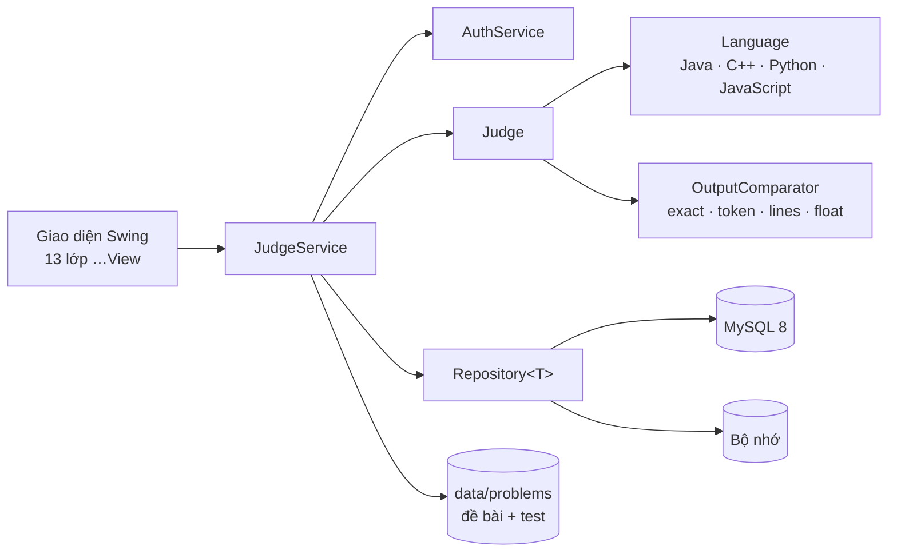

# CodeHub

Ứng dụng chấm bài lập trình tự động viết hoàn toàn bằng Java: giao diện Java Swing (JFrame), chấm được 4 ngôn ngữ và trả kết quả của từng test.


## Giới thiệu

CodeHub là ứng dụng luyện lập trình theo kiểu Codeforces. Người dùng nộp mã nguồn; hệ thống biên dịch, chạy trên bộ test với giới hạn thời gian và bộ nhớ, so sánh output với đáp án rồi trả verdict AC / WA / TLE / MLE / RE / CE cho từng test. Hệ thống có sẵn hai lớp học: lớp Nhập môn (10 chủ đề, 300 bài cho người mới bắt đầu) và lớp Lộ trình VNOI (26 chặng lập trình thi đấu theo [lộ trình tổng quát của VNOI Wiki](https://wiki.vnoi.info/roadmap/general-roadmap), tổng cộng 300 bài).

Chương trình chỉ dùng API chuẩn của JDK: giao diện Swing, băm mật khẩu, bộ chấm đều do nhóm tự viết. Thư viện ngoài duy nhất là MySQL Connector/J; dữ liệu được truy cập bằng JDBC, không qua framework hay ORM.

## Tính năng

### Tài khoản
- Đăng ký, đăng nhập, xem thông tin tài khoản, đăng xuất.
- Mỗi lần đăng nhập tạo một phiên có hạn 8 giờ; hết hạn thì chương trình báo và quay về cửa sổ đăng nhập.
- Ba vai trò Sinh viên / Giảng viên / Quản trị viên. Tài khoản tự đăng ký luôn là Sinh viên. Menu "Quản trị" chỉ hiện với quản trị viên, và tầng điều khiển kiểm tra quyền lại trước khi ghi.

### Học tập
- Hai lớp học, mỗi lớp có lộ trình riêng: lớp Nhập môn gồm 10 chủ đề từ nhập/xuất đến mảng, xâu và sắp xếp; lớp Lộ trình VNOI gồm 26 chặng từ đệ quy, đồ thị đến luồng và quy hoạch động nâng cao. Có theo dõi tiến độ từng chặng, nút *Học tiếp* và *Làm bài tiếp*.
- Lớp Nhập môn có 300 bài mã `K001` đến `K300`; lớp VNOI có 300 bài mã `V001` đến `V300`, mỗi chặng từ 6 đến 16 bài, xếp từ dễ đến khó. Mỗi bài có test ví dụ, test ẩn và lời giải mẫu C++ trong `data/submissions/`.
- Lọc bài theo độ khó, tìm bài theo mã hoặc tên.

### Chấm bài
- Hỗ trợ 4 ngôn ngữ: Java, C++, Python, JavaScript. Thêm ngôn ngữ mới chỉ cần viết một lớp con `Language`.
- Đủ 6 verdict, chấm điểm từng phần theo test.
- Chấm xong, giao diện Làm bài hiện verdict chung, điểm và bảng kết quả từng test (verdict, thời gian chạy, điểm, thông báo).
- 4 kiểu so sánh output: chính xác, theo token, theo dòng (cho bài vẽ hình), số thực có sai số.
- Test ẩn không bao giờ hiện trên giao diện, và thông báo WA không làm lộ đáp án.

### Lịch sử và xếp hạng
- Trang "Trạng thái": giảng viên và quản trị viên thấy bài nộp của mọi người, sinh viên chỉ thấy bài của mình; có ô "Tự làm mới". Trang "Bài nộp" chỉ gồm bài của người đang đăng nhập.
- Nhấn một dòng để xem chi tiết: kết quả từng test và mã nguồn.
- Bảng xếp hạng tính từ toàn bộ bài nộp: tổng điểm cao nhất của từng bài, rồi đến số lần nộp. Phía trên bảng là bục top 3 gồm huy chương, họ tên, tên đăng nhập và số bài đã giải của ba người đứng đầu.

### Quản trị
- Tạo bài tập ngay trên giao diện: đề, giới hạn, kiểu so sánh, test ví dụ và test ẩn. Bài được ghi vào thư mục tạm rồi mới đổi tên thành thư mục thật, nên không có bài nào bị ghi dở. Bài mới dùng được ngay, không cần khởi động lại chương trình.
- Sắp xếp lộ trình: đổi chủ đề và độ khó của từng bài.

### Bảo mật
- Mật khẩu băm bằng PBKDF2-HMAC-SHA256 (120 000 vòng, salt riêng cho từng tài khoản) và so sánh trong thời gian hằng số.
- Token phiên 32 byte sinh bằng `SecureRandom`, hết hạn sau 8 giờ.
- Mọi truy vấn dùng `PreparedStatement`; mã bài và tên test được kiểm tra để chặn path traversal.

## Công nghệ

| Phần | Công nghệ |
|---|---|
| Ngôn ngữ | Java 11 |
| Giao diện | Java Swing (`JFrame`, `JDialog`, `JPanel`, `JTable`) |
| Cơ sở dữ liệu | MySQL 8 (InnoDB, `utf8mb4`) qua JDBC, hoặc lưu trong bộ nhớ khi chạy không có CSDL |
| Công cụ | Maven (tùy chọn, chỉ để tải MySQL Connector/J) |

## Kiến trúc



Các lớp giao diện chỉ gọi tầng nghiệp vụ qua một lớp duy nhất là `JudgeService`. Kho dữ liệu được truyền vào qua constructor (`JudgeService.mysql()` hoặc `JudgeService.inMemory()`), nên đổi giữa MySQL và bộ nhớ không phải sửa tầng nghiệp vụ hay giao diện. Câu SQL chỉ nằm trong package `dao`.

`ProcessRunner` chạy code thí sinh trong tiến trình con. Một luồng ghi stdin, hai luồng đọc stdout và stderr để tiến trình không bị treo khi bộ đệm đầy. Chương trình chạy quá giờ bị dừng cưỡng bức, và output bị cắt ở 1 MB.

### Cấu trúc theo MVC

Mã nguồn chia theo mô hình MVC, mỗi tầng một package:

| Tầng | Thư mục | Chứa gì |
|---|---|---|
| Model (lớp thực thể) | `src/com/ptit/oj/model/` | Dữ liệu của hệ thống: người dùng, bài tập, bài nộp, kết quả chấm |
| View (tầng giao diện) | `src/com/ptit/oj/view/` | Các cửa sổ Swing, mỗi chức năng một package con |
| Controller (tầng điều khiển) | `src/com/ptit/oj/controller/` | Các lớp `…Service` xử lí nghiệp vụ, `judge/` là bộ chấm |
| DAO (tầng truy cập dữ liệu) | `src/com/ptit/oj/dao/` | Đọc ghi MySQL, bộ nhớ và thư mục `data/` |

Chiều phụ thuộc là `view` → `controller` → `dao` → `model`. Có một ngoại lệ: `Submission` giữ ngôn ngữ của bài nộp dưới dạng đối tượng `Language`, mà `Language` biết biên dịch và chạy mã nguồn nên nằm trong `controller/judge/`.

```
src/com/ptit/oj
├── Main.java            Điểm vào: chọn kho MySQL hay bộ nhớ, nạp dữ liệu rồi mở cửa sổ đăng nhập
├── model/               Entity, User → Student / Teacher / Admin, Credentials,
│                        Problem, TestCase, Topic, ProblemDraft,
│                        Submission, JudgeResult, TestCaseResult, Verdict
├── dao/                 Repository<T>, InMemoryRepository<T>,
│                        UserRepository, SubmissionRepository (mỗi cái có bản MySQL và In-memory),
│                        ProblemLoader, ProblemWriter, TopicLoader (đề bài và lộ trình trên ổ đĩa),
│                        DatabaseConfig, MySqlDatabaseManager, MySqlSchemaInitializer,
│                        DataAccessException, ProblemLoadException, TextUtils
├── controller/          JudgeService (điểm vào nghiệp vụ dùng chung),
│   │                    AuthService, PasswordService, SessionService,
│   │                    ProblemAdminService, ScoreboardService
│   └── judge/           Judge, ProcessRunner,
│                        Language (abstract) → 4 ngôn ngữ, LanguageRegistry,
│                        OutputComparator → Exact / Token / Line / Float, ComparatorFactory
└── view/                HomeView (cửa sổ chính, thanh menu), Ui (tiện ích dùng chung)
    ├── account/         LoginView, RegisterView, AccountMenuView
    ├── problem/         ProblemListView (lộ trình + danh sách bài), LearningPath,
    │                    AdminPanelView, ProblemEditorView, ProblemMetaEditorView
    ├── judge/           ProblemDetailView (làm bài), JudgeResultView (kết quả chấm)
    └── history/         SubmissionsView (trạng thái, bài nộp của tôi), SubmissionDetailView, LeaderboardView
```

Bốn module của báo cáo nằm ở các tệp sau:

| Module trong báo cáo | `model/` | `dao/` | `controller/` | `view/` |
|---|---|---|---|---|
| 1. Quản lý tài khoản và phân quyền | `User`, `Student`, `Teacher`, `Admin`, `Credentials` | `UserRepository` và hai bản cài đặt | `AuthService`, `PasswordService`, `SessionService` | `account/`, `HomeView` |
| 2. Quản lý bài tập và lộ trình học | `Problem`, `TestCase`, `Topic`, `ProblemDraft` | `ProblemLoader`, `ProblemWriter`, `TopicLoader` | `ProblemAdminService` | `problem/` |
| 3. Nộp bài và chấm tự động | `Submission`, `JudgeResult`, `TestCaseResult`, `Verdict` | | `judge/` | `judge/` |
| 4. Xem lịch sử nộp bài và bảng xếp hạng | | `SubmissionRepository` và hai bản cài đặt | `ScoreboardService` | `history/` |

`JudgeService` phục vụ cả bốn module.

### Các màn hình

| Lớp giao diện | Loại | Chức năng |
|---|---|---|
| `LoginView` | `JFrame` | Đăng nhập; mở `RegisterView` |
| `RegisterView` | `JDialog` | Đăng ký tài khoản sinh viên |
| `HomeView` | `JFrame` | Cửa sổ chính: thanh menu Lớp học / Trạng thái / Bài nộp / Xếp hạng / Quản trị |
| `AccountMenuView` | `JDialog` | Họ tên, tên đăng nhập, vai trò và nút Đăng xuất |
| `ProblemListView` | `JPanel` | Lộ trình học, tiến độ, bảng bài tập, tìm và lọc bài |
| `ProblemDetailView` | `JDialog` | Đề bài, ví dụ, chọn ngôn ngữ, soạn mã nguồn, nộp bài |
| `JudgeResultView` | `JPanel` | Verdict, số test đúng, điểm, bảng kết quả từng test, nút Làm bài tiếp |
| `SubmissionsView` | `JPanel` | Bảng lịch sử nộp bài (trang Trạng thái và trang Bài nộp) |
| `SubmissionDetailView` | `JDialog` | Chi tiết một bài nộp kèm mã nguồn |
| `LeaderboardView` | `JPanel` | Bục top 3 và bảng xếp hạng |
| `AdminPanelView` | `JPanel` | Bảng bài tập theo lộ trình cho quản trị viên |
| `ProblemEditorView` | `JDialog` | Biểu mẫu New Problem |
| `ProblemMetaEditorView` | `JDialog` | Sửa chủ đề và độ khó của một bài |

## Bắt đầu nhanh

Chỉ cần JDK 11+. MySQL 8 chỉ cần khi muốn lưu dữ liệu lâu dài. Muốn chấm các ngôn ngữ khác Java thì cài thêm toolchain tương ứng (g++, Python 3, Node.js); ngôn ngữ nào thiếu toolchain thì giao diện Làm bài không cho nộp bằng ngôn ngữ đó.

### Chạy thử không cần MySQL

```bash
git clone https://github.com/hienphung910/Online-Judge.git
cd Online-Judge
```

1. Biên dịch vào thư mục `out/`:

   ```bash
   javac -encoding UTF-8 -d out $(find src -name "*.java")
   ```

   Trên PowerShell:

   ```powershell
   javac -encoding UTF-8 -d out (Get-ChildItem -Recurse -Filter *.java src).FullName
   ```

2. Chạy chương trình từ thư mục gốc của project:

   ```bash
   java "-Dfile.encoding=UTF-8" -cp out com.ptit.oj.Main --no-db
   ```

Cửa sổ đăng nhập hiện ra. Lần chạy đầu chương trình tạo 5 tài khoản mẫu: `admin` (quản trị viên), `gvthanh` (giảng viên), `hiennm`, `lananh`, `tuanpv` (sinh viên). Cả năm dùng chung một mật khẩu mẫu, được in ra terminal; muốn dùng mật khẩu khác thì gán biến môi trường `OJ_SEED_PASSWORD` trước khi chạy. Ở chế độ này tài khoản và lịch sử nộp bài nằm trong RAM nên sẽ mất khi tắt chương trình.

### Chạy với MySQL

1. Sửa mật khẩu `THAY_MAT_KHAU_NAY` trong `database/mysql/01_create_database.sql`, rồi chạy file này bằng tài khoản quản trị MySQL. Script tạo CSDL `online_judge` và tài khoản `oj_app` với quyền tối thiểu:

   ```bash
   mysql -u root -p < database/mysql/01_create_database.sql
   ```

2. Tạo file cấu hình rồi điền các biến ở mục [Cấu hình](#cấu-hình):

   ```bash
   cp .env.example .env    # PowerShell: Copy-Item .env.example .env
   ```

3. Tải MySQL Connector/J 8.4.0 vào thư mục `lib/`. Có Maven thì chạy lệnh dưới; không có thì tải file `mysql-connector-j-8.4.0.jar` từ Maven Central rồi chép vào `lib/`:

   ```bash
   mvn -q dependency:copy-dependencies -DoutputDirectory=lib -DincludeScope=runtime
   ```

4. Biên dịch như mục trên, rồi chạy với cả `lib/` trong classpath (Linux / macOS dùng `:` thay cho `;`):

   ```bash
   java "-Dfile.encoding=UTF-8" -cp "out;lib/*" com.ptit.oj.Main
   ```

   Bảng và view được tạo tự động khi khởi động. Lần chạy đầu (bảng `users` còn trống), chương trình tạo 5 tài khoản mẫu như trên.

### Tham số dòng lệnh

| Tham số | Chức năng |
|---|---|
| `--no-db` | Lưu tài khoản và lịch sử nộp bài trong bộ nhớ thay vì MySQL |

Chương trình phải được chạy từ thư mục gốc của project vì đề bài đọc từ `data/`.

## Cấu hình

Mật khẩu không bao giờ nhận qua tham số dòng lệnh.

| Biến | Đọc từ | Ý nghĩa |
|---|---|---|
| `OJ_DB_URL`, `OJ_DB_USER`, `OJ_DB_PASSWORD` | Biến môi trường hoặc file `.env` (biến môi trường được ưu tiên) | Kết nối tới CSDL |
| `OJ_SEED_PASSWORD` | Biến môi trường | Mật khẩu của 5 tài khoản mẫu, chỉ dùng khi chưa có tài khoản nào |

## Định dạng đề bài

Mỗi bài là một thư mục trong `data/problems/`:

```
P001/
├── problem.properties   id, title, timeLimitMs, memoryLimitMb, comparator, totalPoints,
│                        topic, difficulty, order (ba khoá cuối tùy chọn)
├── statement.txt        nội dung đề
└── tests/
    ├── sample01.in / sample01.out   test ví dụ (tên bắt đầu bằng "sample"), hiển thị cho người dùng
    └── 01.in / 01.out ...           test ẩn
```

- `comparator`: `exact`, `token` (mặc định), `lines`, `float` hoặc `float:1e-9`.
- `difficulty`: 1 Dễ, 2 Vừa, 3 Khó. `order`: thứ tự trong chủ đề; bài không có `order` xếp sau theo mã bài.
- Lộ trình khai báo trong `data/topics.txt`, mỗi dòng có dạng `ma-chu-de | Tên | Mô tả | Tên lớp`; thứ tự dòng là thứ tự học. Các chủ đề cùng tên lớp thuộc cùng một lớp, lớp nào xuất hiện trước thì đứng trước.

Lược đồ CSDL gồm ba bảng `users`, `submissions`, `test_case_results` (khoá ngoại `ON DELETE CASCADE`) và view `user_stats`. Mỗi bài nộp cùng kết quả các test được ghi trong một transaction. Xem [database/mysql/02_schema.sql](database/mysql/02_schema.sql).

## Kiểm thử

Project không kèm bộ kiểm thử tự động. Sau khi sửa code, kiểm tra theo hai bước:

- Biên dịch bằng lệnh `javac` ở mục [Bắt đầu nhanh](#bắt-đầu-nhanh); không được có lỗi.
- Chạy chương trình với `--no-db` rồi thử các luồng trên giao diện: đăng ký, đăng nhập, nộp bài, xem lịch sử, xếp hạng, tạo và sửa bài bằng tài khoản `admin`. `data/submissions/demo-plan.txt` liệt kê 41 bài nộp mẫu (đủ 6 verdict, nhiều ngôn ngữ) kèm verdict đúng của từng bài.

## Quy ước viết code

Mã nguồn chỉ dùng cú pháp Java cơ bản để cả nhóm đọc và giải thích được:

- Không dùng lambda, method reference, stream hay `Optional`. Hàm tìm kiếm trả về `null` khi không có, nơi gọi kiểm tra `== null`.
- Lớp giao diện `implements ActionListener`; các nút là thuộc tính của lớp, và `actionPerformed` dùng `e.getSource()` để biết nút nào được nhấn. Nhấn vào dòng của bảng thì dùng `MouseAdapter`.
- Sắp xếp bằng `Collections.sort` với một `Comparator` viết tường minh.
- Rẽ nhánh bằng `if / else`, duyệt bằng `for`; không dùng `switch`, varargs hay `synchronized`.

## Thiết kế hướng đối tượng

| Nguyên lý / mẫu | Áp dụng |
|---|---|
| Kế thừa & đa hình | `User` → `Student` / `Teacher` / `Admin`; quyền lấy từ `canCreateProblem()` thay vì `if` theo vai trò |
| Trừu tượng | `Language`, `User`, `Entity` là abstract class; `OutputComparator`, `Repository<T>` là interface |
| Strategy | `OutputComparator`: đổi cách so sánh mà không sửa `Judge` |
| Factory | `ComparatorFactory`, `LanguageRegistry`, `JudgeService.mysql()` / `inMemory()` |
| Repository + Generic | `Repository<T extends Entity>`, hai bản cài đặt In-memory và MySQL thay thế được cho nhau |
| Dependency Injection | `JudgeService` nhận kho dữ liệu qua constructor |
| Đóng gói | Field `private`, danh sách trả về dạng chỉ đọc, `Credentials` bất biến |
| Đa luồng | `ProcessRunner` dùng luồng riêng để ghi stdin và đọc stdout, stderr của tiến trình con |

## Hạn chế và hướng phát triển

- Chưa có sandbox: code thí sinh chạy bằng quyền người dùng hiện tại, nên chỉ chấm mã nguồn mình tin tưởng. Hướng phát triển: chạy trong container hoặc dùng cgroups / Job Object.
- Giới hạn bộ nhớ chỉ áp chính xác cho Java (`-Xmx`) và JavaScript; các ngôn ngữ còn lại chỉ phát hiện MLE khi runtime báo hết bộ nhớ.
- Là ứng dụng desktop: mỗi lần chạy phục vụ một người dùng. Nhiều máy muốn dùng chung tài khoản và lịch sử nộp bài thì cùng trỏ về một CSDL MySQL; đề bài vẫn nằm trong thư mục `data/` của từng máy.
- Tài khoản mẫu, kể cả `admin`, dùng chung một mật khẩu mẫu; đặt `OJ_SEED_PASSWORD` trước lần chạy đầu nếu dùng ngoài mục đích trình diễn.
- Bài được chấm ngay trên luồng giao diện: trong lúc chấm cửa sổ Làm bài đứng chờ (con trỏ chuột hình đồng hồ cát), chấm xong mới thao tác tiếp được.
- Chưa sửa được nội dung đề, bộ test, chưa xoá bài và chưa đổi mật khẩu qua giao diện; lộ trình (`topics.txt`) và thứ tự bài trong chủ đề (`order`) vẫn sửa tay.
- Phiên đăng nhập lưu trong RAM; chưa có connection pool và phân trang cho lịch sử nộp bài.
- Bộ test lớp VNOI được giữ nhỏ cho repo gọn (khoảng 1 MB mỗi bài với V001–V026, dưới 100 KB mỗi bài với V027–V300), nên ở nhiều bài cách làm trâu viết bằng C++ vẫn kịp giới hạn thời gian; Java và Python thì thường không.

## Nhóm phát triển

Bài tập lớn môn Lập trình hướng đối tượng, Học viện Công nghệ Bưu chính Viễn thông (PTIT).

Thành viên: **hienphung910**, **longnd**, **tm079**, **tienkhoi235**
