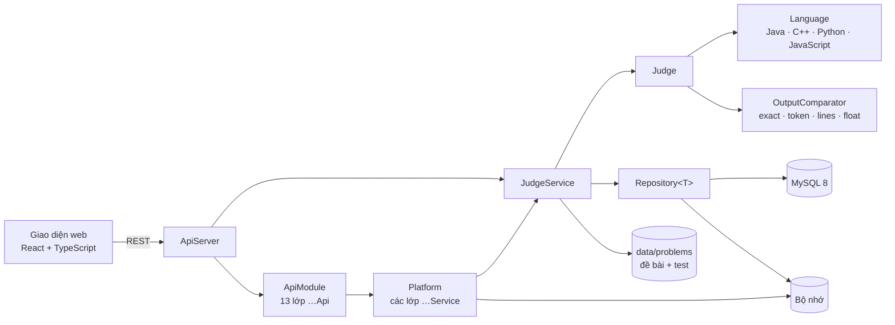

# CodeHub

Nền tảng dạy và luyện lập trình thi đấu: chấm bài tự động, lớp học, kỳ thi và phòng học trực tuyến. Backend viết bằng Java thuần, giao diện web bằng React.


## Giới thiệu

Phần lõi của CodeHub là một trình chấm bài theo kiểu Codeforces. Người dùng nộp mã nguồn; hệ thống biên dịch, chạy trên bộ test với giới hạn thời gian và bộ nhớ, so sánh output với đáp án rồi trả verdict AC / WA / TLE / MLE / RE / CE cho từng test. Hệ thống có sẵn hai lớp học: lớp Nhập môn (10 chủ đề, 300 bài cho người mới bắt đầu) và lớp Lộ trình nâng cao (26 chặng lập trình thi đấu theo [lộ trình tổng quát của VNOI Wiki](https://wiki.vnoi.info/roadmap/general-roadmap), tổng cộng 300 bài).

Quanh phần lõi đó là 40 module chức năng: lớp học, khóa học, bài tập giao, kỳ thi, phòng học, phân tích kết quả, diễn đàn, quản trị. 31 module chạy thật. 9 module còn lại cần hạ tầng mà project không có (truyền video, cổng thanh toán, mô hình AI) nên được làm ở dạng mô phỏng và ghi nhãn "MÔ PHỎNG" ngay trên giao diện. Bảng đầy đủ nằm ở mục [Bốn mươi module](#bốn-mươi-module).

Backend chỉ dùng API chuẩn của JDK. Máy chủ HTTP, bộ đọc/ghi JSON, băm mật khẩu và quản lý phiên đều do nhóm tự viết. Thư viện ngoài duy nhất là MySQL Connector/J; dữ liệu được truy cập bằng JDBC, không qua framework hay ORM.

## Tính năng

> **Giao diện hiện tại** dùng theme vàng - đen theo logo và đã được rút gọn so với danh sách bên dưới:
>
> - **Lịch học** thay cho Phòng học trực tuyến: giảng viên lên lịch buổi học cho lớp và dán link phòng học (Google Meet, Zoom...) vào buổi đó, lúc lên lịch hoặc về sau. Học sinh thấy giờ học, lớp, giảng viên; từ 10 phút trước giờ học tới hết buổi, nút *Tham gia phòng học* mở link đó. Phòng học tự viết (bảng trắng, mã nguồn dùng chung, điểm danh, bản ghi) không còn trên giao diện.
> - **Lớp của tôi** có thêm mục *Bài tập luyện tập*: các bài giảng viên chọn riêng cho lớp. Giảng viên bấm vào một học sinh trong danh sách lớp để xem phân tích học tập của em đó.
> - **Bình luận dưới bài tập**: mỗi bài có phần bình luận ở cuối trang làm bài. Bình luận không qua người duyệt: máy chủ lọc lúc gửi (`CommentFilter.java`), qua được thì hiện ngay. Bộ lọc chặn từ bậy (tiếng Việt có dấu, không dấu, viết tắt, tiếng Anh; quản trị viên bổ sung từ ở Quản trị → Hệ thống hoặc biến `OJ_BANNED_WORDS`) và chặn học sinh đăng mã nguồn lời giải: được trích tối đa 3 dòng mã để hỏi, không được đăng cả chương trình hay đoạn mã vừa đọc dữ liệu vừa in kết quả. Mỗi người tối đa 10 bình luận trong 10 phút. Bình luận lọt lưới thì quản trị viên xoá ở Quản trị → Bình luận bài tập, giảng viên xoá bình luận dưới bài trong kho riêng của mình ở Giảng dạy → Bình luận bài của tôi; người viết nhận thông báo. Bình luận lưu trong RAM như các module mở rộng khác.
> - **Tải file**: trang làm bài có nút icon tải file mã nguồn cạnh nút *Chèn code mẫu* (nội dung file được đưa vào ô soạn, đuôi file quyết định ngôn ngữ). Chỉ nhận một file mã nguồn, không nhận file nén. Form tạo bài có *Tải thư mục test* và *Tải nhiều file test*: mỗi test là một cặp `01.in` + `01.out` (nhận cả `.inp`, `.ans`), hoặc mỗi test một thư mục con kiểu `Test01/BAI.INP` + `Test01/BAI.OUT`; tên bắt đầu bằng `sample` là test ví dụ.
> - **Sinh test** (Công cụ CP): mảng số chọn được số nguyên hoặc số thực; đồ thị chọn được có hướng / vô hướng, có trọng số / không có và số cạnh.
> - **Kỳ thi theo lớp**: mỗi kỳ thi tổ chức cho một lớp, giảng viên chọn lớp lúc tạo (trong các lớp mình quản lý). Chỉ thành viên của lớp đó và quản trị viên thấy kỳ thi; chỉ học sinh của lớp vào thi được; bảng xếp hạng chỉ tính bài của thí sinh đã bấm *Vào thi*, nộp sau lúc vào. Học sinh của lớp nhận thông báo khi có kỳ thi mới. Xoá lớp thì các kỳ thi của lớp cũng bị xoá.
> - **Chế độ thi**: trong lúc kỳ thi diễn ra, học sinh mở trang kỳ thi và bấm *Vào thi* mới thấy đề. Từ đó cho tới khi bấm *Nộp bài sớm* hoặc hết giờ, giao diện của học sinh chỉ còn màn hình thi: danh sách bài của kỳ thi, ô nộp bài, bảng xếp hạng và đồng hồ đếm ngược; không có menu, thông báo, bình luận hay phần phân tích / gợi ý sau khi nộp. Trạng thái này lưu ở máy chủ nên tải lại trang hay đăng nhập lại vẫn ở trong bài thi. Máy chủ cũng tự chặn: học sinh đang thi chỉ gọi được API cần cho việc thi (đề của kỳ thi, nộp bài, kết quả của mình, bảng xếp hạng); chat, bình luận, chạy thử mã, lớp học, phân tích đều bị từ chối dù gọi thẳng API. Học sinh của lớp chưa bấm *Vào thi* thì không mở và không nộp được bài của kỳ thi đang diễn ra, kể cả bài kho chung. Nộp bài sớm rồi thì không vào lại được và các bài nộp sau đó không tính vào kỳ thi.
> - **Giám sát kỳ thi** (người tạo kỳ thi bật / tắt được, lúc tạo hoặc ngay trong khi thi): khi bật, trình duyệt của thí sinh đang trong bài thi ghi lại việc rời tab, chuyển sang cửa sổ khác, sao chép / cắt / dán và đóng hoặc tải lại trang; một thanh trên màn hình thi báo cho thí sinh biết đang bị giám sát. Người tạo kỳ thi xem danh sách thí sinh đã vào thi, bảng tổng hợp theo thí sinh và nhật ký sự kiện ngay trên trang kỳ thi (tự cập nhật), và nhận thông báo khi một thí sinh có vi phạm đầu tiên, rồi cứ mỗi 10 lần. Chỉ ghi độ dài nội dung sao chép / dán, không ghi nội dung. Việc ghi nhận sự kiện do trình duyệt của thí sinh thực hiện nên chỉ có tác dụng với người dùng thông thường: tắt JavaScript hoặc dùng thêm thiết bị khác thì không bị ghi lại. Nhật ký lưu trong RAM.
> - **Tài khoản quản trị** không có các mục Lớp của tôi, Bài tập được giao, Lịch học, nhóm Cá nhân và nhóm Giảng dạy; đổi mật khẩu vẫn mở được từ menu ở ảnh đại diện.
> - **Đã bỏ**: Khóa học và tài liệu, Thành tích, Gói dịch vụ, Stress test, Trợ lý AI (cả pop-up ở trang làm bài), Diễn đàn, Trợ lý giảng dạy, Phụ huynh, phòng học trực tuyến, phần xem lại diễn biến của kỳ thi, và phần điểm yếu trong Phân tích học tập. API của các phần này cũng đã gỡ khỏi máy chủ; các mục mô tả chúng ở phần dưới của tài liệu này là của phiên bản cũ.
> - **Phân quyền**: giảng viên chỉ xem được bài nộp (kèm mã nguồn) của học sinh lớp mình dạy. Mỗi lớp chỉ có một giảng viên phụ trách (đã bỏ trợ giảng). Giảng viên mời học sinh bằng tên đăng nhập thì học sinh phải tự đồng ý mới vào lớp. Kỳ thi do giảng viên phụ trách lớp, người tạo (khi còn dạy lớp đó) và quản trị viên quản lý; đề chỉ sửa được trước khi thi, đang thi chỉ gia hạn được. Quản trị viên duyệt, khoá, xoá, đổi vai trò tài khoản ở Quản trị → Tài khoản, nhưng không tự tạo tài khoản mới được: tài khoản chỉ sinh ra qua đăng ký (học sinh dùng ngay, giảng viên chờ duyệt), muốn thêm quản trị viên thì đổi vai trò của một tài khoản đã có. Trang Nhật ký hoạt động đã bỏ; nhật ký vẫn được ghi ra `data/audit/audit.log` trên máy chủ.
> - **Bảo mật**: đăng nhập sai nhiều lần bị tạm khoá (8 lần / 10 phút cho một tên từ một địa chỉ), đăng ký bị giới hạn theo địa chỉ; mỗi người chỉ có một bài đang chấm và cả hệ thống tối đa 16 bài chờ; nhật ký hoạt động được ghi nối tiếp ra `data/audit/audit.log`; mọi phản hồi có header bảo mật (CSP, `X-Frame-Options`, `nosniff`); chủ bài kho riêng và chủ kỳ thi được ghi bằng mã tài khoản thay cho tên đăng nhập.
> - **Bài tập giao**: một bài chỉ tính là đã làm khi AC trong khoảng từ lúc giao tới hạn nộp. AC sau hạn hiện là *Nộp muộn*, AC từ trước khi giao hiện là *Đã giải từ trước*; cả hai không tính vào tiến độ.
> - **Ô soạn mã** (trang làm bài, IDE trực tuyến, xem lại bài nộp) dùng CodeMirror, tô màu cú pháp theo bảng màu Dark+ của Visual Studio Code.
>
> API của các phần đã bỏ khỏi giao diện vẫn còn ở backend và trong bảng REST API bên dưới.

### Chấm bài
- Hỗ trợ 4 ngôn ngữ: Java, C++, Python, JavaScript. Thêm ngôn ngữ mới chỉ cần viết một lớp con `Language`.
- Đủ 6 verdict, chấm điểm từng phần theo test.
- Chấm xong, trang làm bài hiện verdict chung, điểm và bảng kết quả từng test (verdict, thời gian chạy, điểm, thông báo).
- 4 kiểu so sánh output: chính xác, theo token, theo dòng (cho bài vẽ hình), số thực có sai số.
- Test ẩn không bao giờ được gửi xuống trình duyệt, và thông báo WA không làm lộ đáp án. Với test ẩn, thông báo WA và RE chỉ ghi loại lỗi; nội dung do chương trình in ra (giá trị sai, dòng đầu của stderr) chỉ hiện ở test ví dụ, để bài nộp không dùng thông báo lỗi làm kênh lấy input của test ẩn.

### Học tập
- Hai lớp học, mỗi lớp có lộ trình riêng: lớp Nhập môn gồm 10 chủ đề từ nhập/xuất đến mảng, xâu và sắp xếp; lớp Lộ trình nâng cao gồm 26 chặng từ đệ quy, đồ thị đến luồng và quy hoạch động nâng cao. Có theo dõi tiến độ từng chặng, nút *Học tiếp* và *Bài tiếp theo*.
- Lớp Nhập môn có 300 bài mã `K001` đến `K300`; lớp Lộ trình nâng cao có 300 bài mã `V001` đến `V300`, mỗi chặng từ 6 đến 16 bài, xếp từ dễ đến khó. Mỗi bài có test ví dụ, test ẩn và lời giải mẫu C++ trong `data/submissions/`.
- Lọc bài theo độ khó, tìm bài theo mã hoặc tên, bảng xếp hạng.
- Trang làm bài có trợ lý dạng pop-up ở góc dưới bên phải. Trợ lý biết đang ở bài nào, đọc mã nguồn trong ô soạn và tự nhận xét sau mỗi lần nộp.
- Chuỗi ngày luyện tập (streak) hiện bằng biểu tượng ngọn lửa trên thanh tiêu đề. Bấm vào để xem 7 ngày gần nhất, mốc tiếp theo và lịch 16 tuần.

### Lớp học và giảng dạy
- Giảng viên tạo lớp, gắn lớp vào một tổ chức và một khóa học. Học sinh nhập mã tham gia 8 ký tự sinh ngẫu nhiên cho từng lớp (giảng viên xem ở trang chi tiết lớp) để gửi yêu cầu vào lớp; giảng viên duyệt ở mục "Yêu cầu vào lớp" thì học sinh mới thành thành viên, chưa duyệt thì chưa thấy bài, chat hay danh sách lớp. Giảng viên cũng mời được học sinh theo tên đăng nhập và xoá học sinh khỏi lớp. Học sinh đã bị xoá khỏi lớp không tự xin vào lại được.
- Khóa học có giáo trình là danh sách bài giảng, mỗi bài giảng kèm các bài tập luyện. Tài liệu học tập là văn bản hoặc đường link.
- Giao bài cho lớp kèm hạn nộp. Tiến độ của từng học sinh tính từ lịch sử nộp bài, giảng viên xem được bảng tiến độ cả lớp.
- Mỗi giảng viên có một kho bài riêng: tự tạo bài, sửa bộ test, đổi chủ đề và độ khó của bài mình. Bài kho riêng không hiện ở lộ trình chung. Học sinh mở được bài khi giảng viên đưa nó vào kỳ thi, bài tập giao hoặc bài giảng. Giảng viên không sửa được kho bài chung và không dùng được bài trong kho của giảng viên khác. Bài kho riêng tính điểm trong kỳ thi chứa nó, còn bảng xếp hạng chung, điểm thưởng và thống kê kỹ năng chỉ tính kho bài chung.
- Kỳ thi xếp hạng theo số bài giải được; bằng nhau thì ai giải xong bài cuối cùng của mình sớm hơn đứng trước. Nộp sai không bị trừ điểm hay cộng phút phạt.
- Kỳ thi thuộc về người tạo. Người tạo và quản trị viên thêm, bớt bài hoặc xoá kỳ thi; giảng viên khác chỉ xem.
- Danh bạ phụ huynh và báo cáo học tập soạn sẵn để gửi về gia đình.
- Trang tổng quan cho giảng viên: số tài khoản, lượt nộp theo ngày, phân bố verdict, năm bài được nộp nhiều nhất.

### Phòng học trực tuyến
- Lên lịch, bắt đầu và kết thúc buổi học cho từng lớp. Học sinh vào phòng khi buổi học đang diễn ra.
- Trong phòng có ô mã nguồn dùng chung (chủ phòng gõ, cả lớp thấy; bật "cùng lập trình" thì cả lớp cùng sửa), nút chạy thử, bảng trắng, giơ tay, chat và danh sách người đang có mặt.
- Điểm danh tự động khi học sinh vào phòng, vào muộn quá 10 phút tính là đi muộn. Giảng viên sửa tay được.
- Buổi học có bật ghi lại sẽ lưu mã nguồn cuối buổi, bảng trắng và nội dung chat thành một bản ghi.
- Phòng học là bản mô phỏng: trình duyệt hỏi lại trạng thái phòng mỗi 1,5 giây thay cho kết nối thời gian thực. Xem mục [Các module mô phỏng](#các-module-mô-phỏng).

### Công cụ
- IDE trực tuyến: chạy thử mã nguồn với input tự nhập, giới hạn 5 giây, không tính là nộp bài.
- Stress test: nhập lời giải cần kiểm tra, lời giải vét cạn và chương trình sinh test. Máy chủ chạy tối đa 30 vòng trong 25 giây và dừng ở input đầu tiên làm hai lời giải cho kết quả khác nhau.
- Công cụ CP chạy trong trình duyệt: sinh test ngẫu nhiên (mảng, hoán vị, cây, đồ thị, xâu), so sánh hai output, ước lượng độ phức tạp theo giới hạn của đề.

### Phân tích và thành tích
- Hồ sơ học tập của từng học sinh: số lượt nộp, tỉ lệ AC, hoạt động 14 ngày, điểm kỹ năng theo chủ đề, chủ đề yếu, kiểu lỗi hay gặp và danh sách bài gợi ý. Giảng viên xem được hồ sơ của học sinh.
- Điểm thưởng 10 / 20 / 40 cho mỗi bài Dễ / Vừa / Khó đã giải, năm hạng từ Tập sự đến Kim cương, tám huy hiệu.
- Mọi con số ở đây đều tính lại từ lịch sử nộp bài mỗi lần mở trang, không có bảng thống kê lưu riêng.

### Cộng đồng
- Thông báo tự sinh khi có bài tập mới, buổi học mới hoặc khi giảng viên gửi thông báo cho lớp. Số thông báo chưa đọc hiện trên chuông ở thanh tiêu đề.
- Chat theo kênh: kênh chung, kênh của từng lớp, kênh của từng phòng học.
- Diễn đàn: đăng chủ đề, trả lời, gắn chủ đề với một bài tập.

### Quản trị
- Tạo bài tập cho kho bài chung trên web: đề, giới hạn, kiểu so sánh, test ví dụ và test ẩn. Bài được ghi vào thư mục tạm rồi mới đổi tên thành thư mục thật, nên không có bài nào bị ghi dở. Bài mới dùng được ngay, không cần khởi động lại máy chủ.
- Sắp xếp lộ trình: đổi chủ đề và độ khó của từng bài.
- Quản lý bộ test: xem toàn bộ test của một bài (kể cả test ẩn), thêm và xoá từng test.
- Tạo tài khoản giảng viên, học sinh, quản trị. Tài khoản quản trị chỉ tạo được ở đây. Quản lý tổ chức.
- Cấu hình hệ thống: thông báo chung hiện ở đầu mọi trang, bật hoặc tắt việc tự đăng ký.
- Ba vai trò Học sinh / Giảng viên / Quản trị. Khi đăng ký, người dùng chọn Học sinh hoặc Giảng viên; máy chủ từ chối mọi yêu cầu đăng ký vai trò Quản trị. Backend kiểm tra quyền ở từng request, kể cả khi giao diện đã ẩn nút.

### Bảo mật
- Mật khẩu băm bằng PBKDF2-HMAC-SHA256 (120 000 vòng, salt riêng cho từng tài khoản) và so sánh trong thời gian hằng số.
- Token phiên 32 byte sinh bằng `SecureRandom`, hết hạn sau 8 giờ. Đổi mật khẩu sẽ huỷ mọi phiên khác của tài khoản đó.
- Mọi truy vấn dùng `PreparedStatement`; mã bài và tên test được kiểm tra để chặn path traversal.
- Nhật ký hoạt động ghi mọi request làm thay đổi dữ liệu (POST, PUT, DELETE) và mọi lần đăng nhập, kể cả đăng nhập sai, ra file `data/audit/audit.log`. Không còn trang xem trên web; người vận hành đọc file trên máy chủ.
- Máy chủ mặc định chỉ lắng nghe trên `127.0.0.1`; chỉ mở ra ngoài khi đặt `OJ_BIND_ADDRESS`.

## Các module mô phỏng

Chín module dưới đây không làm thật được với một máy chủ HTTP viết bằng JDK chuẩn. Giao diện ghi nhãn "MÔ PHỎNG" ở từng trang tương ứng.

| Module | Bản mô phỏng làm gì | Thiếu gì so với bản thật |
|---|---|---|
| 14 Virtual Classroom, 17 Live Coding, 18 Collaborative Coding, 19 Whiteboard | Trình duyệt hỏi máy chủ trạng thái phòng mỗi 1,5 giây (polling) | Kết nối thời gian thực. Khi nhiều người cùng sửa mã, bản gửi sau ghi đè bản trước |
| 16 Video & Audio Conference | Bật camera và micro của chính máy mình để xem trước | Truyền hình và tiếng tới người khác |
| 27 AI Teaching Assistant, 28 AI Coding Assistant | Câu trả lời ghép từ các luật viết sẵn, dựa trên verdict gần nhất, vài dấu hiệu trong mã nguồn và từ khóa trong câu hỏi | Mô hình AI. Mã nguồn của học sinh không được gửi ra ngoài máy chủ |
| 34 Payment & Subscription | Bấm nút là ghi nhận một giao dịch thành công, gói có hiệu lực 30 ngày | Cổng thanh toán. Không nhập thông tin thẻ, không có tiền thật |
| 37 Recording Management | Lưu mã nguồn cuối buổi, bảng trắng và chat | Ghi hình, ghi âm |

Module 15 (Meeting Management) và 20 (Attendance Management) chạy thật, dù chúng nằm cùng trang với phòng học.

## Bốn mươi module

Cột "Ở đâu" ghi đường đi trên menu của giao diện.

| # | Module | Ở đâu | Mức độ |
|---|---|---|---|
| 1 | User & Account Management | Trang đăng nhập và đăng ký (chọn Học sinh hoặc Giảng viên); Cá nhân → Tài khoản của tôi; Quản trị → Tài khoản, giảng viên | Chạy thật |
| 2 | Organization Management | Quản trị → Tổ chức | Chạy thật |
| 3 | Classroom Management | Học tập → Lớp của tôi | Chạy thật |
| 4 | Course Management | Học tập → Khóa học, tài liệu | Chạy thật |
| 5 | Curriculum & Learning Path | Học tập → Lớp học | Chạy thật |
| 6 | Problem Management | Quản trị → Kho bài chung và bộ test; Giảng dạy → Kho bài của tôi | Chạy thật |
| 7 | Testcase Management | Nút Test ở hai trang của module 6 | Chạy thật |
| 8 | Judge Engine | Trang làm bài | Chạy thật |
| 9 | Submission Management | Lịch sử → Trạng thái, Bài nộp | Chạy thật |
| 10 | Online IDE | Công cụ → IDE trực tuyến | Chạy thật |
| 11 | Advanced CP Tools | Công cụ → Công cụ CP | Chạy thật |
| 12 | Stress Testing | Công cụ → Stress test | Chạy thật |
| 13 | Assignment Management | Học tập → Bài tập được giao | Chạy thật |
| 14 | Virtual Classroom | Học tập → Phòng học trực tuyến | Mô phỏng |
| 15 | Meeting Management | Học tập → Phòng học trực tuyến | Chạy thật |
| 16 | Video & Audio Conference | Trong phòng học | Mô phỏng |
| 17 | Live Coding | Trong phòng học | Mô phỏng |
| 18 | Collaborative Coding | Trong phòng học | Mô phỏng |
| 19 | Whiteboard & Interactive Tools | Trong phòng học | Mô phỏng |
| 20 | Attendance Management | Học tập → Phòng học trực tuyến, nút Điểm danh | Chạy thật |
| 21 | Contest Management | Học tập → Kỳ thi | Chạy thật |
| 22 | Contest Replay | Trang chi tiết kỳ thi | Chạy thật |
| 23 | Student Analytics | Cá nhân → Phân tích học tập | Chạy thật |
| 24 | Skill Assessment | Cá nhân → Phân tích học tập | Chạy thật |
| 25 | Weakness Detection | Cá nhân → Phân tích học tập | Chạy thật |
| 26 | Learning Recommendation | Cá nhân → Phân tích học tập | Chạy thật |
| 27 | AI Teaching Assistant | Giảng dạy → Trợ lý giảng dạy | Mô phỏng |
| 28 | AI Coding Assistant | Pop-up trong trang làm bài; Công cụ → Trợ lý AI | Mô phỏng |
| 29 | Notification Management | Chuông trên thanh tiêu đề; Cộng đồng → Thông báo | Chạy thật |
| 30 | Communication & Chat | Cộng đồng → Chat; trong lớp và trong phòng học | Chạy thật |
| 31 | Discussion Forum | Cộng đồng → Diễn đàn | Chạy thật |
| 32 | Parent Management | Giảng dạy → Phụ huynh | Chạy thật |
| 33 | Reporting & Dashboard | Giảng dạy → Tổng quan | Chạy thật |
| 34 | Payment & Subscription | Cá nhân → Gói dịch vụ | Mô phỏng |
| 35 | Teacher Management | Quản trị → Tài khoản, giảng viên (duyệt, khoá, đổi vai trò) | Chạy thật |
| 36 | Document Management | Học tập → Khóa học, tài liệu | Chạy thật |
| 37 | Recording Management | Học tập → Phòng học trực tuyến, mục Bản ghi | Mô phỏng |
| 38 | Gamification | Cá nhân → Thành tích; ngọn lửa streak trên thanh tiêu đề | Chạy thật |
| 39 | System Administration | Quản trị → Hệ thống | Chạy thật |
| 40 | Security & Audit Management | Nhật ký ghi ra `data/audit/audit.log` (đã bỏ trang xem trên web) | Chạy thật |

Nhóm Giảng dạy chỉ hiện với giảng viên và quản trị viên, nhóm Quản trị chỉ hiện với quản trị viên. Mục Kho bài của tôi chỉ hiện với giảng viên.

## Công nghệ

| Tầng | Công nghệ |
|---|---|
| Backend | Java 11, `com.sun.net.httpserver`, JDBC |
| Cơ sở dữ liệu | MySQL 8 (InnoDB, `utf8mb4`), hoặc lưu trong bộ nhớ khi chạy không có CSDL |
| Frontend | React 19, TypeScript 5, Vite 7, Tailwind CSS 4 |
| Công cụ | Maven (tùy chọn) |

## Kiến trúc



`ApiServer` tự xử lí các endpoint của phần lõi (đăng nhập, bài tập, nộp bài, bảng xếp hạng) qua `JudgeService`. Kho dữ liệu của `JudgeService` được truyền vào qua constructor (`JudgeService.mysql()` hoặc `JudgeService.inMemory()`), nên đổi giữa MySQL và bộ nhớ không phải sửa tầng nghiệp vụ hay giao diện. Câu SQL chỉ nằm trong package `dao`.

Mọi endpoint còn lại đi theo cùng một đường. `ApiServer.route()` bọc request vào một đối tượng `Request` rồi hỏi lần lượt 10 lớp con của `ApiModule` trong `controller/api/`; lớp nào nhận ra đường dẫn của mình thì xử lí. Mỗi lớp `…Api` làm ba việc: kiểm tra quyền, gọi lớp `…Service` tương ứng, đổi kết quả thành JSON. Các service được tạo và giữ trong `Platform`.

Ví dụ với yêu cầu tạo lớp học: trình duyệt gửi `POST /api/classrooms`, `SchoolApi.handle()` gọi `req.staff()` để chặn học sinh, `SchoolService.createClassroom()` kiểm tra dữ liệu và lưu một đối tượng `Classroom` vào `InMemoryRepository`, rồi `SchoolApi` trả JSON của lớp vừa tạo.

`ProcessRunner` chạy code thí sinh trong tiến trình con. Một luồng ghi stdin, hai luồng đọc stdout và stderr để tiến trình không bị treo khi bộ đệm đầy. Chương trình chạy quá giờ bị dừng cưỡng bức, và output bị cắt ở 1 MB. IDE trực tuyến và stress test dùng lại `Language` và `ProcessRunner`, và khóa chung với bộ chấm để không chạy song song với việc chấm bài.

### Dữ liệu lưu ở đâu

| Dữ liệu | Chạy với MySQL | Chạy với `--no-db` |
|---|---|---|
| Tài khoản, bài nộp, kết quả từng test | MySQL | Bộ nhớ |
| Đề bài và test | `data/problems/` | `data/problems/` |
| Tổ chức, lớp học, bài tập giao, lịch học, kỳ thi, nhật ký giám sát, thông báo, chat, bình luận, cấu hình | Bộ nhớ, tự lưu xuống `data/state/` vài giây một lần và nạp lại khi khởi động (`StateStore.java`) | Bộ nhớ (đặt `OJ_PERSIST_STATE=true` để lưu như chế độ MySQL) |
| Nhật ký hoạt động, file minh chứng đăng ký | `data/audit/`, `data/evidence/` | `data/audit/`, `data/evidence/` |

Bài của kho chung và bài kho riêng của giảng viên nằm cùng thư mục `data/problems/`. Bài kho riêng có thêm dòng `owner=<tên đăng nhập>` trong `problem.properties`, nên khởi động lại máy chủ vẫn biết bài của ai.

Dữ liệu ở dòng cuối mất khi tắt máy chủ. Mỗi lần khởi động, `DemoData` tạo lại một bộ dữ liệu mẫu: một tổ chức, hai khóa học, một lớp với các tài khoản mẫu, một bài tập giao, một buổi học và hai kỳ thi. Ở chế độ `--no-db`, `DemoData` tạo thêm 24 bài nộp mẫu để các trang phân tích và xem lại kỳ thi có số liệu ngay. Các bài này không qua bộ chấm và có dòng "BÀI NỘP MẪU" trong phần thông báo. Muốn tắt, đổi `seed(noDatabase)` thành `seed(false)` trong `Main.java`.

### Cấu trúc theo MVC

Mã nguồn chia theo mô hình MVC, mỗi tầng một thư mục, khớp với mục 5.3 của báo cáo phân tích thiết kế:

| Tầng | Thư mục | Chứa gì |
|---|---|---|
| Model (lớp thực thể) | `src/com/ptit/oj/model/` | Dữ liệu của hệ thống: người dùng, bài tập, bài nộp, lớp học, kỳ thi, buổi học |
| Controller (tầng điều khiển) | `src/com/ptit/oj/controller/` | `ApiServer` và các lớp `api/…Api` nhận yêu cầu từ giao diện, các lớp `…Service` xử lí nghiệp vụ, `judge/` là bộ chấm |
| DAO (tầng truy cập dữ liệu) | `src/com/ptit/oj/dao/` | Đọc ghi MySQL, bộ nhớ và thư mục `data/` |
| View (tầng giao diện) | `frontend/src/view/` | Các trang React, mỗi chức năng một thư mục |

Chiều phụ thuộc là `view` → `controller` → `dao` → `model`. Giao diện chỉ nói chuyện với backend qua REST API. Có một ngoại lệ: `Submission` giữ ngôn ngữ của bài nộp dưới dạng đối tượng `Language`, mà `Language` biết biên dịch và chạy mã nguồn nên nằm trong `controller/judge/`.

```
src/com/ptit/oj
├── Main.java            Điểm vào: chọn kho MySQL hay bộ nhớ, tạo Platform và dữ liệu mẫu, mở máy chủ web
├── model/               Entity, User → Student / Teacher / Admin, Credentials,
│                        Problem, TestCase, Topic, ProblemDraft,
│                        Submission, JudgeResult, TestCaseResult, Verdict,
│                        Organization, Classroom, ParentContact, Course, Lesson, Document, Assignment,
│                        Meeting, MeetingRoom, Stroke, Attendance, Recording, Contest,
│                        Notification, ChatMessage, ForumPost, Plan, Payment, AuditLog
├── dao/                 Repository<T>, InMemoryRepository<T>, IdGenerator,
│                        UserRepository, SubmissionRepository (mỗi cái có bản MySQL và In-memory),
│                        ProblemLoader, ProblemWriter, TopicLoader (đề bài và lộ trình trên ổ đĩa),
│                        DatabaseConfig, MySqlDatabaseManager, MySqlSchemaInitializer,
│                        DataAccessException, ProblemLoadException, TextUtils
└── controller/          ApiServer (REST API + phục vụ file tĩnh), Json, ApiException, Check,
    │                    JudgeService (điểm vào nghiệp vụ của phần lõi),
    │                    AuthService, PasswordService, SessionService,
    │                    ProblemAdminService, ScoreboardService,
    │                    Platform (tạo và giữ các service dưới đây), DemoData (dữ liệu mẫu),
    │                    SchoolService, CourseService, AssignmentService, MeetingService,
    │                    ContestService, AnalyticsService, AssistantService, CommunityService,
    │                    BillingService, SystemService, PlaygroundService
    ├── api/             Request, ApiModule (abstract) → AccountApi, SchoolApi,
    │                    AssignmentApi, MeetingApi, ContestApi, AnalyticsApi,
    │                    CommunityApi, SystemApi, PlaygroundApi, TestcaseApi
    └── judge/           Judge, ProcessRunner,
                         Language (abstract) → 4 ngôn ngữ, LanguageRegistry,
                         OutputComparator → Exact / Token / Line / Float, ComparatorFactory

frontend/src
├── main.tsx, App.tsx    Khung ứng dụng: thanh tiêu đề, menu theo nhóm, streak, chuông thông báo
├── shared/              api.ts, types.ts (phần lõi); platformApi.ts, platformTypes.ts (module mở rộng);
│                        kit.tsx (khung trang, thẻ, nút, bảng, biểu đồ cột), nav.ts, ProblemChip.tsx,
│                        ui.tsx, Logo.tsx
└── view/
    ├── account/         auth.tsx, LoginModal.tsx, MyAccount.tsx, StreakBadge.tsx, streak.ts
    ├── problem/         Problems.tsx (lộ trình + danh sách bài), learningPath.ts,
    │                    admin/ AdminPanel.tsx, ProblemEditor.tsx, ProblemMetaEditor.tsx, TestcaseManager.tsx
    ├── judge/           ProblemDetail.tsx (làm bài + kết quả chấm), CodeEditor.tsx, TestTable.tsx,
    │                    AssistantPopup.tsx (trợ lý pop-up)
    ├── history/         Submissions.tsx (trạng thái), MySubmissions.tsx (bài nộp của tôi), Leaderboard.tsx
    ├── school/          Classrooms.tsx, Courses.tsx, Assignments.tsx
    ├── contest/         Contests.tsx (danh sách, chi tiết, xem lại)
    ├── meeting/         Meetings.tsx (buổi học, điểm danh, bản ghi), Room.tsx (phòng học), Whiteboard.tsx
    ├── tools/           Playground.tsx (IDE), CpTools.tsx, StressTest.tsx, Assistant.tsx
    ├── profile/         Analytics.tsx, Achievements.tsx, Billing.tsx
    ├── community/       Forum.tsx, ChatPage.tsx, ChatBox.tsx, Notifications.tsx
    ├── manage/          Dashboard.tsx, TeachingAssistant.tsx, Parents.tsx
    └── admin/           Accounts.tsx, Organizations.tsx, SystemAdmin.tsx, AuditLogs.tsx
```

Bốn module của báo cáo nằm ở các tệp sau:

| Module trong báo cáo | `model/` | `dao/` | `controller/` | `view/` |
|---|---|---|---|---|
| 1. Quản lý tài khoản và phân quyền | `User`, `Student`, `Teacher`, `Admin`, `Credentials` | `UserRepository` và hai bản cài đặt | `AuthService`, `PasswordService`, `SessionService` | `account/` |
| 2. Quản lý bài tập và lộ trình học | `Problem`, `TestCase`, `Topic`, `ProblemDraft` | `ProblemLoader`, `ProblemWriter`, `TopicLoader` | `ProblemAdminService` | `problem/` |
| 3. Nộp bài và chấm tự động | `Submission`, `JudgeResult`, `TestCaseResult`, `Verdict` | | `judge/` | `judge/` |
| 4. Xem lịch sử nộp bài và bảng xếp hạng | | `SubmissionRepository` và hai bản cài đặt | `ScoreboardService` | `history/` |

`ApiServer` và `JudgeService` phục vụ cả bốn module. Các module mở rộng nằm ở các tệp sau:

| Nhóm module | `model/` | `controller/` | `controller/api/` | `view/` |
|---|---|---|---|---|
| Tài khoản, giảng viên (1, 35) | `User` và các lớp con | `AuthService` | `AccountApi` | `account/`, `admin/Accounts.tsx` |
| Tổ chức, lớp học, phụ huynh (2, 3, 32) | `Organization`, `Classroom`, `ParentContact` | `SchoolService` | `SchoolApi` | `school/`, `admin/`, `manage/` |
| Khóa học, tài liệu (4, 36) | `Course`, `Lesson`, `Document` | `CourseService` | (API đã gỡ) | `school/Courses.tsx` |
| Bộ test (7) | `TestCase` | `ProblemAdminService` | `TestcaseApi` | `problem/admin/TestcaseManager.tsx` |
| IDE, stress test (10, 12) | | `PlaygroundService` | `PlaygroundApi` | `tools/` |
| Bài tập giao (13) | `Assignment` | `AssignmentService` | `AssignmentApi` | `school/Assignments.tsx` |
| Buổi học, phòng học, điểm danh, bản ghi (14 đến 20, 37) | `Meeting`, `MeetingRoom`, `Stroke`, `Attendance`, `Recording` | `MeetingService` | `MeetingApi` | `meeting/` |
| Kỳ thi, xem lại (21, 22) | `Contest` | `ContestService` | `ContestApi` | `contest/` |
| Phân tích, báo cáo, thành tích (23 đến 26, 33, 38) | | `AnalyticsService` | `AnalyticsApi` | `profile/`, `manage/Dashboard.tsx` |
| Trợ lý AI (27, 28) | | `AssistantService` | (API đã gỡ) | `judge/AssistantPopup.tsx`, `tools/Assistant.tsx`, `manage/TeachingAssistant.tsx` |
| Thông báo, chat, diễn đàn (29, 30, 31) | `Notification`, `ChatMessage`, `ForumPost` | `CommunityService` | `CommunityApi` | `community/` |
| Thanh toán (34) | `Plan`, `Payment` | `BillingService` | (API đã gỡ) | `profile/Billing.tsx` |
| Hệ thống, nhật ký (39, 40) | `AuditLog` | `SystemService` | `SystemApi` | `admin/` |

Module 11 (Công cụ CP) chỉ có phần giao diện trong `tools/CpTools.tsx`.

## Bắt đầu nhanh

Cần có JDK 11+ và Node.js 20.19+. MySQL 8 chỉ cần khi muốn lưu tài khoản và bài nộp lâu dài. Muốn chấm các ngôn ngữ khác Java thì cài thêm toolchain tương ứng (g++, Python 3, Node.js); ngôn ngữ nào thiếu toolchain sẽ tự được đánh dấu là không khả dụng.

### Chạy thử không cần MySQL

```bash
git clone https://github.com/hienphung910/Online-Judge.git
cd Online-Judge
```

1. Biên dịch backend vào thư mục `out/`:

   ```bash
   javac -encoding UTF-8 -d out $(find src -name "*.java")
   ```

   Trên PowerShell:

   ```powershell
   javac -encoding UTF-8 -d out (Get-ChildItem -Recurse -Filter *.java src).FullName
   ```

2. Build giao diện web vào `frontend/dist/`:

   ```bash
   cd frontend
   npm install
   npm run build
   cd ..
   ```

3. Khởi động máy chủ từ thư mục gốc của project:

   ```bash
   java "-Dfile.encoding=UTF-8" -cp out com.ptit.oj.Main --serve --no-db
   ```

Mở http://localhost:8080. Mật khẩu tài khoản `admin` và mật khẩu chung của bốn tài khoản mẫu (`hiennm`, `lananh`, `tuanpv` là học sinh, `gvthanh` là giảng viên) được in ra terminal; muốn tự đặt mật khẩu admin thì gán biến môi trường `OJ_ADMIN_PASSWORD` trước khi chạy. Ở chế độ này mọi dữ liệu trừ đề bài nằm trong RAM nên sẽ mất khi tắt máy chủ.

Muốn thử phòng học, mở hai tab: một tab đăng nhập `gvthanh`, một tab đăng nhập một tài khoản học sinh. Phiên đăng nhập lưu riêng theo tab nên không cần hai trình duyệt.

Nếu máy chủ báo `Unable to establish loopback connection` dù cổng không bận (gặp trên Windows với JDK 17), thêm `"-Djdk.net.unixdomain.tmpdir=C:\Users\Public"` vào ngay sau `java`.

### Chạy với MySQL

1. Sửa mật khẩu `THAY_MAT_KHAU_NAY` trong `database/mysql/01_create_database.sql`, rồi chạy file này bằng tài khoản quản trị MySQL. Script tạo CSDL `online_judge` và tài khoản `oj_app` với quyền tối thiểu:

   ```bash
   mysql -u root -p < database/mysql/01_create_database.sql
   ```

2. Tạo file cấu hình rồi điền các biến ở mục [Cấu hình](#cấu-hình):

   ```bash
   cp .env.example .env    # PowerShell: Copy-Item .env.example .env
   ```

3. Tải MySQL Connector/J 8.4.0 vào thư mục `lib/`. Có Maven thì chạy lệnh dưới; không có thì tải file `mysql-connector-j-8.4.0.jar` từ Maven Central rồi chép vào `lib/`:

   ```bash
   mvn -q dependency:copy-dependencies -DoutputDirectory=lib -DincludeScope=runtime
   ```

4. Biên dịch backend và build giao diện như mục trên, rồi khởi động máy chủ với cả `lib/` trong classpath (Linux / macOS dùng `:` thay cho `;`):

   ```bash
   java "-Dfile.encoding=UTF-8" -cp "out;lib/*" com.ptit.oj.Main --serve
   ```

   Bảng và view được tạo tự động khi khởi động. Lần chạy đầu, hệ thống tạo tài khoản `admin` và 4 tài khoản mẫu.

### Tham số dòng lệnh

Tham số của backend (`java -cp "out;lib/*" com.ptit.oj.Main ...`; Linux / macOS dùng `:` thay cho `;`):

| Tham số | Chức năng |
|---|---|
| `--serve[=port]` | Mở REST API và giao diện web, mặc định cổng 8080 |
| `--no-db` | Lưu tài khoản và lịch sử nộp bài trong bộ nhớ thay vì MySQL |

Chương trình phải được chạy từ thư mục gốc của project: đề bài đọc từ `data/`, giao diện đọc từ `frontend/dist/`.

## Cấu hình

Các biến được đọc từ biến môi trường hoặc file `.env` (biến môi trường được ưu tiên). Mật khẩu không bao giờ nhận qua tham số dòng lệnh.

| Biến | Ý nghĩa |
|---|---|
| `OJ_DB_URL`, `OJ_DB_USER`, `OJ_DB_PASSWORD` | Kết nối tới CSDL |
| `OJ_ADMIN_PASSWORD` | Mật khẩu admin lần đầu. Bỏ trống thì hệ thống tự sinh: chế độ `--no-db` in ra màn hình một lần; chạy với CSDL thật thì ghi vào `data/admin-password.txt` (không in ra log), đọc xong hãy xoá file |
| `OJ_SEED_PASSWORD` | Mật khẩu của 4 tài khoản mẫu. Không có mật khẩu mặc định: bỏ trống thì chế độ `--no-db` sinh ngẫu nhiên và in ra, còn chạy với CSDL thật thì không tạo tài khoản mẫu |
| `OJ_SANDBOX_USER` | Tên tài khoản hệ thống dùng để chạy bài nộp (image Docker đặt sẵn `ojrunner`). Máy chủ tự kiểm tra lúc khởi động và in dòng `Cô lập bài nộp: Bật / Tắt`; cũng hiện ở Quản trị → Hệ thống. Bỏ trống, hoặc máy không chạy được `sudo`, thì bài nộp chạy bằng chính tài khoản của máy chủ |
| `OJ_BANNED_WORDS` | Từ cấm bổ sung cho bộ lọc bình luận, cách nhau dấu phẩy. Quản trị viên sửa được trong Quản trị → Hệ thống, giá trị đã sửa được lưu lại cùng dữ liệu lớp học; biến này chỉ là giá trị ban đầu |
| `OJ_TRUST_PROXY` | Lấy địa chỉ người dùng từ đâu để giới hạn tần suất. `true` (image Docker đặt sẵn): máy chủ đứng sau một lớp proxy, lấy giá trị cuối của `X-Forwarded-For`. `cloudflare`: có Cloudflare đứng trước, lấy `CF-Connecting-IP` (nên đặt kèm `OJ_ORIGIN_SECRET`). Không đặt khi máy chủ nhận kết nối trực tiếp |
| `OJ_ORIGIN_SECRET` | Chỉ nhận request đi qua Cloudflare: đặt một chuỗi bí mật ở đây, và trên Cloudflare tạo Transform Rule gắn header `X-Origin-Secret` với đúng chuỗi đó vào mọi request. Request thiếu hoặc sai header bị trả về 403 (trừ `/api/health`). Bỏ trống thì không kiểm tra |
| `OJ_TURNSTILE_SITE_KEY`, `OJ_TURNSTILE_SECRET` | Bật CAPTCHA Cloudflare Turnstile cho form đăng nhập và đăng ký khi đặt cả hai (lấy ở trang Turnstile của Cloudflare). Máy chủ gọi Cloudflare để xác minh token trước khi kiểm tra mật khẩu hoặc tạo tài khoản. Nếu Cloudflare không gọi được thì không ai đăng nhập được: xoá hai biến này để tắt CAPTCHA |
| `RESEND_API_KEY`, `OJ_MAIL_FROM`, `OJ_PUBLIC_URL` | Bật chức năng quên mật khẩu qua email khi đặt cả ba. Thư gửi bằng REST API của [Resend](https://resend.com) trên HTTPS (Railway chặn SMTP ở các gói dưới Pro). `RESEND_API_KEY`: khoá loại Sending access, giới hạn trong tên miền gửi thư. `OJ_MAIL_FROM`: người gửi, ví dụ `CodeHub <no-reply@mail.example.com>`, tên miền phải đã xác minh ở Resend. `OJ_PUBLIC_URL`: địa chỉ trang web (ví dụ `https://example.com`) để dựng link trong thư; máy chủ không lấy địa chỉ này từ header `Host` của request. Thiếu một trong ba thì form đăng nhập không hiện "Quên mật khẩu?" |
| `OJ_BIND_ADDRESS` | Địa chỉ lắng nghe. Bỏ trống thì chỉ nghe `127.0.0.1`; trong container đặt `0.0.0.0` (Dockerfile đã đặt sẵn) |
| `OJ_ALLOW_REGISTER` | `true` / `false`: mở hay khoá tự đăng ký lúc khởi động. Bỏ trống thì mở, trừ khi máy chủ đang mở ra mạng mà việc cô lập bài nộp không bật được (lúc đó mặc định khoá). Quản trị viên vẫn đổi được trong Quản trị → Hệ thống cho tới lần khởi động sau |

Mọi biến ở bảng trên đều đọc được từ biến môi trường hoặc từ file `.env`.

## Triển khai bằng Docker (Railway + Aiven)

`Dockerfile` ở thư mục gốc đóng gói máy chủ, giao diện đã build và toolchain chấm bài (javac, g++, python3, node) vào một image. MySQL nằm ngoài image.

- Railway: tạo service từ repo GitHub, Railway tự nhận `Dockerfile` và cấp cổng qua biến `PORT`. Gắn một Volume vào `/app/data` để đề bài tạo trên web không mất khi deploy lại; lúc khởi động, đề bài gốc trong repo được chép vào volume mà không ghi đè bài đã có.
- Aiven MySQL bắt buộc SSL: trong `OJ_DB_URL` dùng `sslMode=REQUIRED` thay cho `useSSL=false`, tên CSDL là `defaultdb`. Không cần chạy `01_create_database.sql`; bảng được tạo khi khởi động.
- Đặt `OJ_ADMIN_PASSWORD` trước lần chạy đầu. Sau khi deploy, xem log có dòng `Cô lập bài nộp: Bật` không. Nếu là `Tắt` (nền tảng không cho chạy `sudo`), bài nộp chạy bằng quyền của máy chủ và tự đăng ký mặc định bị khoá; chỉ đặt `OJ_ALLOW_REGISTER=true` khi chấp nhận rủi ro đó.
- Khi cô lập bật, bài nộp chạy bằng tài khoản `ojrunner`: không đọc được `data/` (test ẩn, file minh chứng), không đọc được mật khẩu trong biến môi trường của máy chủ, không dừng được máy chủ, bị giới hạn số tiến trình, kích thước file và bộ nhớ (C++, Python). Việc cô lập này KHÔNG chặn kết nối mạng ra ngoài.
- Dữ liệu mẫu (lớp, kỳ thi mẫu) chỉ được tạo ở chế độ `--no-db`. `database/mysql/03_seed_demo_data.sql` dùng mật khẩu công khai, chỉ nạp trên máy cá nhân.

Chạy thử image trên máy, không cần MySQL:

```bash
docker build -t codehub .
docker run --rm -p 8080:8080 codehub --no-db
```

## REST API

Trừ 4 endpoint công khai, mọi request phải gửi header `Authorization: Bearer <token>`.

### Phần lõi

| Method | Endpoint | Quyền | Mô tả |
|---|---|---|---|
| GET | `/api/health` | công khai | Trạng thái máy chủ |
| GET | `/api/languages` | công khai | Danh sách ngôn ngữ và trạng thái toolchain |
| GET | `/api/config` | công khai | Cấu hình form đăng nhập / đăng ký cần biết trước khi có phiên: `turnstileSiteKey` (rỗng nếu CAPTCHA tắt), `allowRegister`, `passwordReset` (máy chủ có gửi được email đặt lại mật khẩu không) |
| POST | `/api/auth/register` | công khai | Đăng ký tài khoản. Bắt buộc có `email` (dùng để lấy lại mật khẩu, mỗi email một tài khoản). `role` là `STUDENT` (mặc định) hoặc `TEACHER`, giá trị khác bị từ chối. Học sinh dùng được ngay; giảng viên ở trạng thái chờ duyệt (`pending: true`) và chưa đăng nhập được cho tới khi quản trị viên duyệt. Khi bật CAPTCHA phải gửi kèm `captcha` (token Turnstile). Giảng viên bắt buộc gửi kèm `evidence`: file minh chứng dạng base64 (PNG, JPG, WEBP hoặc PDF, tối đa 1 MB), lưu ở `data/evidence/`. Cả hai bị từ chối khi quản trị viên tắt tự đăng ký |
| POST | `/api/auth/login` | công khai | Đăng nhập, trả về token. Khi bật CAPTCHA phải gửi kèm `captcha` (token Turnstile) |
| POST | `/api/auth/logout` | đăng nhập | Huỷ token |
| GET | `/api/auth/me` | đăng nhập | Thông tin tài khoản đang đăng nhập |
| POST | `/api/auth/password` | đăng nhập | Đổi mật khẩu của chính mình. Nhập sai mật khẩu hiện tại 8 lần trong 10 phút (tính chung với `/api/auth/email`) thì bị tạm khoá chức năng này. Đổi xong, liên kết đặt lại mật khẩu đã xin trước đó bị huỷ |
| PUT | `/api/auth/email` | đăng nhập | Đổi email khôi phục của chính mình; phải gửi kèm `password` (mật khẩu hiện tại). Khi máy chủ gửi được thư, email mới chỉ ở trạng thái chờ (`pendingEmail`) cho tới khi người dùng bấm liên kết trong thư xác minh; email cũ vẫn dùng tới lúc đó |
| POST | `/api/auth/email/resend` | đăng nhập | Gửi lại thư xác minh cho email đang chờ (cách nhau ít nhất 60 giây) |
| POST | `/api/auth/email/verify` | công khai | Xác minh email bằng `token` trong liên kết `/verify-email?token=...` của thư (hiệu lực 24 giờ, dùng một lần). Email chỉ được ghi vào tài khoản ở bước này; hai tài khoản cùng khai một địa chỉ thì ai xác minh trước được địa chỉ đó |
| POST | `/api/auth/forgot` | công khai | Quên mật khẩu: `account` là tên đăng nhập hoặc email. Luôn trả lời cùng một câu dù tài khoản có tồn tại hay không; nếu có và đã khai email thì gửi thư chứa link `/reset-password?token=...` (hiệu lực 30 phút, dùng một lần). Giới hạn: gửi lại cho cùng một tên phải cách nhau 60 giây (trả 429 kèm số giây phải đợi, giao diện đếm ngược trên nút), 10 yêu cầu / giờ mỗi địa chỉ, mỗi tài khoản tối đa 1 thư / phút, 3 thư / giờ, 6 thư / ngày (quá thì lặng lẽ không gửi). Trả 503 nếu chưa cấu hình gửi email |
| POST | `/api/auth/reset/check` | công khai | Mã trong link còn dùng được không: `{ valid }` |
| POST | `/api/auth/reset` | công khai | Đặt mật khẩu mới bằng `token` trong link và `password`. Thành công thì mã bị huỷ và mọi phiên đăng nhập cũ của tài khoản bị đăng xuất |
| GET | `/api/problems` | đăng nhập | Các bài người gọi mở được, kèm đề, chủ đề, độ khó, chủ bài và test ví dụ. Kho chung ai cũng thấy; bài kho riêng chỉ mở qua lớp của mình (bài luyện tập, bài tập giao, kỳ thi của lớp). Bài của kỳ thi đang diễn ra chỉ mở cho học sinh đang ở trong bài thi; đang thi thì chỉ thấy bài của kỳ thi đó |
| GET | `/api/topics` | đăng nhập | Lộ trình học theo thứ tự |
| GET | `/api/submissions` | đăng nhập | Lịch sử nộp: học sinh chỉ thấy của mình; giảng viên thấy của học sinh các lớp mình dạy và bài nộp vào bài thuộc kho của mình; admin thấy tất cả |
| GET | `/api/submissions/{id}` | người nộp / GV của lớp / admin | Chi tiết từng test và mã nguồn (cùng quy tắc với danh sách). Học sinh đang trong bài thi chỉ xem được bài nộp của chính bài thi đó |
| GET | `/api/scoreboard` | đăng nhập | Bảng xếp hạng |
| POST | `/api/submit` | đăng nhập, mở được bài | Nộp bài; chấm xong trả về bài nộp kèm kết quả từng test |
| POST | `/api/admin/problems` | GV / admin | Tạo bài tập. Bài của admin vào kho chung, bài của giảng viên vào kho riêng của người đó |
| PUT | `/api/admin/problems/{id}` | admin; GV với bài của mình | Sửa bài: `title`, `statement`, `timeLimitMs`, `memoryLimitMb`, `topic`, `difficulty` (trường nào không gửi thì giữ nguyên) |
| DELETE | `/api/admin/problems/{id}` | admin; GV với bài của mình | Xoá bài. Từ chối nếu bài đã có bài nộp hoặc đang nằm trong kỳ thi, bài tập giao, bài luyện tập của lớp |
| GET, POST | `/api/admin/problems/{id}/tests` | admin; GV với bài của mình | Xem toàn bộ test của bài, thêm một test |
| DELETE | `/api/admin/problems/{id}/tests/{tên}` | admin; GV với bài của mình | Xoá một test |

### Module mở rộng

"Quản lý lớp" là quản trị viên hoặc giảng viên phụ trách lớp đó. "Thành viên lớp" gồm người quản lý lớp và học sinh của lớp. Ở các endpoint nhận danh sách mã bài (kỳ thi, bài tập giao, bài giảng), giảng viên chỉ dùng được bài kho chung và bài trong kho của mình.

| Method | Endpoint | Quyền | Mô tả |
|---|---|---|---|
| GET | `/api/users` | admin | Danh sách tài khoản |
| POST | `/api/admin/users/{id}/approve` | admin | Duyệt giảng viên tự đăng ký; file minh chứng bị xoá |
| POST | `/api/admin/users/{id}/reject` | admin | Từ chối: xoá tài khoản đang chờ duyệt và file minh chứng |
| GET | `/api/admin/users/{id}/evidence` | admin | File minh chứng của tài khoản đang chờ duyệt (`contentType`, `data` dạng base64) |
| POST | `/api/admin/users/{id}/lock` | admin | Khoá tài khoản đang dùng: bị đăng xuất ngay, không đăng nhập lại được; mở lại bằng `approve` |
| PUT | `/api/admin/users/{id}/role` | admin | Đổi vai trò (`role`). Tài khoản bị đăng xuất và rời các lớp đang tham gia; không hạ quyền giảng viên đang phụ trách lớp |
| DELETE | `/api/admin/users/{id}` | admin | Xoá hẳn tài khoản (không xoá chính mình, không xoá giảng viên đang phụ trách lớp) |
| GET | `/api/organizations` | đăng nhập | Danh sách tổ chức |
| POST, DELETE | `/api/organizations`, `/api/organizations/{id}` | admin | Thêm, xoá tổ chức |
| GET | `/api/classrooms` | đăng nhập | Các lớp mình thuộc về (admin thấy tất cả) |
| POST | `/api/classrooms` | GV / admin | Tạo lớp |
| GET | `/api/classrooms/{id}` | thành viên lớp | Chi tiết lớp: học sinh, lời mời đang chờ, bài luyện tập |
| DELETE | `/api/classrooms/{id}` | GV phụ trách / admin | Xoá lớp |
| POST | `/api/classrooms/{mã tham gia}/join` | học sinh | Xin vào lớp bằng mã tham gia (không phải mã lớp). Chỉ tạo yêu cầu chờ giảng viên duyệt (`pending: true`); học sinh đã được mời sẵn thì vào lớp luôn (`pending: false`) |
| GET | `/api/classroom-requests` | đăng nhập | Các yêu cầu vào lớp của mình đang chờ duyệt |
| DELETE | `/api/classrooms/{id}/request` | đăng nhập | Tự huỷ yêu cầu vào lớp của mình |
| POST | `/api/classrooms/{id}/requests/{userId}/approve`, `.../reject` | quản lý lớp | Duyệt hoặc từ chối một yêu cầu vào lớp; học sinh nhận thông báo |
| POST | `/api/classrooms/{id}/students` | quản lý lớp | Mời học sinh bằng `username`. Học sinh chỉ vào lớp sau khi tự đồng ý |
| DELETE | `/api/classrooms/{id}/students/{userId}` | GV phụ trách / admin | Xoá học sinh khỏi lớp, hoặc rút lời mời |
| GET | `/api/classroom-invites` | đăng nhập | Các lời mời vào lớp đang chờ mình trả lời |
| POST | `/api/classrooms/{id}/accept`, `.../decline` | người được mời | Đồng ý hoặc từ chối lời mời vào lớp |
| POST, DELETE | `/api/classrooms/{id}/problems`, `.../problems/{mã bài}` | quản lý lớp | Thêm (`problemIds`), bỏ bài luyện tập riêng của lớp. Chi tiết lớp trả danh sách này trong `practice` |
| GET | `/api/assignments` | đăng nhập | Bài tập giao của các lớp mình thuộc về, kèm tiến độ của mình |
| POST, DELETE | `/api/assignments`, `/api/assignments/{id}` | quản lý lớp | Giao bài, xoá bài tập giao |
| GET | `/api/assignments/{id}/progress` | quản lý lớp | Bảng tiến độ cả lớp |
| GET | `/api/meetings` | đăng nhập | Buổi học của các lớp mình thuộc về |
| POST, DELETE | `/api/meetings`, `/api/meetings/{id}` | quản lý lớp | Lên lịch, xoá buổi học |
| PUT | `/api/meetings/{id}/link` | quản lý lớp | Dán, sửa link phòng học của một buổi trong lịch (chỉ nhận `http://`, `https://`; gửi rỗng để gỡ). Học sinh chỉ nhận được link trong `GET /api/meetings` khi buổi học đang mở |
| POST | `/api/contests/{id}/join`, `.../finish` | học sinh | Vào thi (khi kỳ thi đang diễn ra); nộp bài sớm để kết thúc bài thi của mình |
| PUT | `/api/contests/{id}/proctoring` | quản lý kỳ thi | Bật, tắt giám sát (`on`) |
| PUT | `/api/contests/{id}/schedule` | quản lý kỳ thi | Đổi giờ thi (`startAt`, `durationMin`). Chưa bắt đầu: đổi được cả hai. Đang diễn ra: chỉ gia hạn được thời lượng. Đã kết thúc: không sửa |
| POST | `/api/contests/{id}/proctor` | đăng nhập | Trình duyệt thí sinh báo một sự kiện giám sát (`type`, `detail`, `problemId`). Chỉ lưu khi kỳ thi đang diễn ra và người gửi là học sinh |
| GET | `/api/contests/{id}/proctor` | quản lý kỳ thi | Nhật ký giám sát: tổng hợp theo thí sinh và 300 sự kiện mới nhất |
| GET | `/api/contests`, `/api/contests/{id}?minute=N`, `/api/contests/{id}/events` | đăng nhập | Danh sách kỳ thi; bảng xếp hạng tại phút N; diễn biến nộp bài |
| POST | `/api/contests` | quản lý lớp | Tạo kỳ thi cho một lớp (`classroomId` bắt buộc). Giờ bắt đầu không được nằm trong quá khứ. Quản lý kỳ thi = GV phụ trách lớp, người tạo (khi còn dạy lớp đó) và admin |
| POST, DELETE | `/api/contests/{id}/problems`, `/api/contests/{id}/problems/{mã bài}` | quản lý kỳ thi | Thêm, bớt một bài của kỳ thi. Chỉ làm được trước khi kỳ thi bắt đầu |
| DELETE | `/api/contests/{id}` | quản lý kỳ thi | Xoá kỳ thi |
| GET | `/api/analytics/me` | đăng nhập | Hồ sơ học tập của mình |
| GET | `/api/analytics/users/{username}` | admin; GV với học sinh lớp mình | Hồ sơ học tập của một học sinh |
| GET | `/api/dashboard` | GV / admin | Số liệu toàn hệ thống |
| GET, POST | `/api/notifications`, `/api/notifications/read` | đăng nhập | Thông báo của mình; đánh dấu đã đọc |
| GET, POST | `/api/chat/{kênh}?after=N` | đăng nhập; kênh lớp cần là thành viên lớp | Đọc các tin có số thứ tự (`seq`) lớn hơn N; gửi tin nhắn (tối đa 30 tin mỗi phút). Tin nhắn qua cùng bộ lọc với bình luận dưới bài (`CommentFilter.java`): từ ngữ không phù hợp bị chặn với mọi người, mã nguồn lời giải bị chặn với học sinh. Mỗi kênh giữ 500 tin gần nhất |
| GET, POST | `/api/problems/{mã bài}/comments` | đăng nhập, mở được bài | Bình luận dưới một bài; gửi bình luận mới (`text`, tối đa 1000 ký tự). Bình luận hiện ngay nếu qua bộ lọc từ bậy và mã nguồn lời giải, không thì trả về 400 kèm lý do |
| DELETE | `/api/comments/{id}` | tác giả; admin; GV với bài kho riêng của mình | Xoá bình luận. Người khác xoá thì tác giả nhận thông báo |
| GET | `/api/admin/comments` | admin; GV với bài kho riêng của mình | Các bình luận mình xoá được, mới nhất trước |
| GET | `/api/settings` | đăng nhập | Cấu hình công khai |
| PUT | `/api/admin/settings` | admin | Đổi cấu hình |
| GET | `/api/admin/system` | admin | Thông tin máy chủ |
| POST | `/api/run` | đăng nhập | Chạy thử mã nguồn |

Tên kênh chat: `general`, `class-<mã lớp>`, `meeting-<mã buổi học>`.

Mã lỗi: `400` dữ liệu sai, `401` chưa đăng nhập, `403` không đủ quyền, `404` không tìm thấy, `409` trùng tên đăng nhập hoặc mã bài, `500` lỗi nội bộ (chi tiết chỉ ghi vào log máy chủ).

## Định dạng đề bài

Mỗi bài là một thư mục trong `data/problems/`:

```
P001/
├── problem.properties   id, title, timeLimitMs, memoryLimitMb, comparator, totalPoints,
│                        topic, difficulty, order, owner (bốn khoá cuối tùy chọn)
├── statement.txt        nội dung đề
└── tests/
    ├── sample01.in / sample01.out   test ví dụ (tên bắt đầu bằng "sample"), hiển thị cho người dùng
    └── 01.in / 01.out ...           test ẩn
```

- `comparator`: `exact`, `token` (mặc định), `lines`, `float` hoặc `float:1e-9`.
- `owner`: tên đăng nhập của giảng viên sở hữu bài. Không có dòng này thì bài thuộc kho chung. Máy chủ tự ghi dòng này khi giảng viên tạo bài trên web và không nhận giá trị từ trình duyệt.
- `difficulty`: 1 Dễ, 2 Vừa, 3 Khó. `order`: thứ tự trong chủ đề; bài không có `order` xếp sau theo mã bài.
- Lộ trình khai báo trong `data/topics.txt`, mỗi dòng có dạng `ma-chu-de | Tên | Mô tả | Tên lớp`; thứ tự dòng là thứ tự học. Các chủ đề cùng tên lớp thuộc cùng một lớp, lớp nào xuất hiện trước thì đứng trước.

Lược đồ CSDL gồm ba bảng `users`, `submissions`, `test_case_results` (khoá ngoại `ON DELETE CASCADE`) và view `user_stats`. Mỗi bài nộp cùng kết quả các test được ghi trong một transaction. Xem [database/mysql/02_schema.sql](database/mysql/02_schema.sql). Các module mở rộng không thêm bảng nào.

## Kiểm thử

Project không kèm bộ kiểm thử tự động. Sau khi sửa code, kiểm tra theo ba bước:

- Biên dịch backend bằng lệnh `javac` ở mục [Bắt đầu nhanh](#bắt-đầu-nhanh); không được có lỗi.
- Trong `frontend/`: `npx tsc --noEmit` kiểm tra kiểu, `npm run build` build giao diện.
- Chạy máy chủ với `--no-db` rồi thử bộ chấm bằng tay: `data/submissions/demo-plan.txt` liệt kê 41 bài nộp mẫu (đủ 6 verdict, nhiều ngôn ngữ) kèm verdict đúng của từng bài.

Các module mở rộng mới được thử ở chế độ `--no-db`, bằng cách gọi API và bấm trên giao diện với cả ba vai trò.

## Thiết kế hướng đối tượng

| Nguyên lý / mẫu | Áp dụng |
|---|---|
| Kế thừa & đa hình | `User` → `Student` / `Teacher` / `Admin`; quyền lấy từ `canCreateProblem()` và `canEditProblem(Problem)` thay vì `if` theo vai trò. `canEditProblem` ở `User` trả về false, `Teacher` ghi đè để chỉ nhận bài của mình, `Admin` ghi đè để nhận mọi bài. `ApiModule` → 13 lớp `…Api`; `ApiServer` gọi `handle()` mà không cần biết đang cầm lớp nào |
| Trừu tượng | `Language`, `User`, `Entity`, `ApiModule` là abstract class; `OutputComparator`, `Repository<T>` là interface |
| Strategy | `OutputComparator`: đổi cách so sánh mà không sửa `Judge` |
| Factory | `ComparatorFactory`, `LanguageRegistry`, `JudgeService.mysql()` / `inMemory()` |
| Repository + Generic | `Repository<T extends Entity>`, hai bản cài đặt In-memory và MySQL thay thế được cho nhau. Mọi thực thể của module mở rộng dùng chung `InMemoryRepository<T>` |
| Dependency Injection | `JudgeService` nhận kho dữ liệu qua constructor; các service của `Platform` nhận `JudgeService` và service khác qua constructor |
| Enum | `Verdict`, `Plan` |
| Đóng gói | Field `private`, danh sách trả về dạng chỉ đọc, `Credentials` bất biến |
| Đa luồng | Luồng đọc/ghi riêng cho tiến trình con, `ConcurrentHashMap` cho phiên, chấm tuần tự để đo thời gian ổn định, `InMemoryRepository` và các hàm sửa danh sách trong service là `synchronized` |

## Hạn chế và hướng phát triển

- Cô lập bài nộp mới ở mức "tài khoản hệ thống riêng + giới hạn tài nguyên" và chỉ có trong image Docker (xem `Sandbox.java`); chạy trực tiếp trên máy cá nhân thì code thí sinh vẫn chạy bằng quyền người dùng hiện tại. Chưa chặn được kết nối mạng của bài nộp. Hướng phát triển: container hoặc namespace riêng cho từng lần chạy (nsjail, isolate), cgroups.
- Giới hạn bộ nhớ chỉ áp chính xác cho Java (`-Xmx`) và JavaScript; các ngôn ngữ còn lại chỉ phát hiện MLE khi runtime báo hết bộ nhớ.
- Bài được chấm tuần tự để số đo thời gian ổn định, và người nộp phải chờ chấm xong mới thấy kết quả; có thể chuyển sang hàng đợi, nhiều worker và đẩy kết quả từng test theo thời gian thực. Một lần stress test cũng giữ bộ chấm tối đa 25 giây.
- Chưa sửa được nội dung đề và chưa xoá được bài qua giao diện; lộ trình (`topics.txt`) và thứ tự bài trong chủ đề (`order`) vẫn sửa tay.
- Giảng viên tự đăng ký là dùng được ngay, chưa có bước quản trị viên duyệt. Muốn chặn thì tắt tự đăng ký ở Quản trị → Hệ thống rồi tạo tài khoản giảng viên bằng tay.
- Kho bài riêng gắn với tên đăng nhập. Ở chế độ `--no-db` tài khoản mất khi tắt máy chủ còn bài vẫn nằm trên đĩa, nên người đăng ký lại đúng tên đó sẽ nhận kho bài cũ.
- Phiên đăng nhập lưu trong RAM; chưa có connection pool và phân trang cho lịch sử nộp bài.
- Dữ liệu của các module mở rộng sống trong RAM và được chụp xuống `data/state/platform.bin` (tuần tự hoá của Java), không nằm trong MySQL. Khi triển khai phải gắn Volume vào `data/` thì deploy lại mới không mất. Đổi kiểu hoặc đổi tên trường của các lớp trong `model/` làm bản lưu cũ không đọc được (máy chủ giữ file cũ lại với đuôi `.bad` và bắt đầu từ trống); thêm trường mới thì không sao. Phiên đăng nhập không được lưu, khởi động lại là mọi người đăng nhập lại. Hướng phát triển: thêm bảng MySQL và lớp DAO cho từng thực thể.
- Các module mở rộng chưa được chạy thử ở chế độ MySQL. Các trang phân tích, tổng quan, chi tiết lớp và xem lại kỳ thi đọc lại toàn bộ lịch sử nộp bài ở mỗi request, nên sẽ chậm dần khi CSDL lớn.
- Phòng học đồng bộ bằng polling, và máy chủ chỉ mở trên localhost nên mới thử được trên một máy với nhiều tab. Bản thật cần WebSocket cho dữ liệu và WebRTC cho video.
- Bộ test lớp Lộ trình nâng cao được giữ nhỏ cho repo gọn (khoảng 1 MB mỗi bài với V001 đến V026, dưới 100 KB mỗi bài với V027 đến V300), nên ở nhiều bài cách làm trâu viết bằng C++ vẫn kịp giới hạn thời gian; Java và Python thì thường không.

## Nhóm phát triển

Bài tập lớn môn Công Nghệ Phần Mềm, Học viện Công nghệ Bưu chính Viễn thông (PTIT).

Thành viên: hienphung910, longnd, tm079, tienkhoi235
